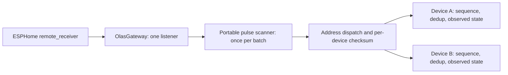

# Architecture and migration boundary

## Existing reference

The single-device `esphome/olas-rf-gateway.yaml` keeps its template fan and
RX-to-TX guard. Its only configuration change for the core PR is the codec's
include path. The canonical codec now lives inside `components/olas` so the
external component is self-contained; the old host include forwards to it.
The reference still returns the first matching RX frame in a batch.

## First step of #16: shared receive-only core

One ESP32-S2 and one CC1101 must ultimately support at least two independently
addressed fans. This is a required design constraint, not an optional extension.

- `olas_protocol.h`: portable bit packing, pulse scanning and integrity check.
  `next_raw_frame` advances a caller-owned cursor. It decodes pulses without an
  expected address; policy follows dispatch. `decode_raw` preserves the old API.
- `olas_core.h`: portable `GatewayCore` stores non-owning device pointers and
  rejects duplicate/out-of-range addresses. Each `Device` holds its own address,
  check byte, next sequence (initially 1), duplicate history and `FanState`.
  RX validates integrity before modifying anything, resynchronizes the addressed
  device and maps only speeds/off. Unmapped functions only synchronize sequence.
- `olas.h/.cpp`: thin ESPHome `Component` / `RemoteReceiverListener` adapter.
  Codegen uses `remote_base.register_listener`, which counts the required static
  listener slot in 2026.10.1. The adapter namespace is `esphome::olas_component`
  to avoid ambiguity with the portable `::olas` namespace in generated C++.
- `__init__.py`: one gateway with a nonempty `devices` list. Device IDs are typed
  for later entity bindings. Addresses are 0..0xFFFFFF, checks 0..0xFF; both must
  be explicit integers (booleans are rejected). Duplicate addresses, duplicate
  IDs, missing fields and unresolved/wrong-type transport references are rejected.
- The typed `transmitter_id` is reserved. **No radio send API, queue, CC1101 mode
  switching, native fan or light platform is supplied by this PR.** `take_command`
  is pure frame construction for the future transport and host tests. It consumes
  one device sequence and does not publish state or touch RF hardware.

The full build fixture is `tests/fixtures/olas-core.yaml`, using two synthetic
pairs. It must never be flashed. For an ESPHome YAML under `esphome/`, the local
component source is `../components`; the fixture uses `../../components`.
The directory follows ESPHome's [external-component layout](https://esphome.io/components/external_components/),
so a later pinned Git source can load the same `components/olas` directory;
private-repository authentication is not assumed or tested.

## State and duplicate semantics

`FanState.known` starts false. Successful RX of speed/off marks the command as
observed, not physical telemetry; off retains the last nonzero speed. The core
has no RX-to-TX path. Future entities must publish received state without calling
control/send. Fan and future light entities must reference the **same Device**,
without their own sequence/dedup copies.

The existing 400 ms exact-frame filter is retained independently per device.
Distinct sequences/functions pass immediately; rejected copies cannot reset
sequence or extend the window. It is a heuristic, not authentication or proven
press-boundary detection. Same-bits fast presses, held buttons, missed packets
and four-command sequence wrap remain hardware questions (#7).

## Next PR: serialized TX and native fan

Keep the legacy YAML as the regression reference. Implement the shared TX path
(#5) and `fan.py` against typed device IDs, including validation of duplicate fan
bindings and invalid device references. Preserve optimistic/unknown semantics
(#14). Before using RF TX, test A → B → A and these transport invariants:

1. Only the gateway uses the bound transmitter; all entities enqueue logical
   device/function jobs. Reject queue overflow explicitly, without advancing
   sequence. Construct the frame when dequeuing so recent RX can synchronize it.
2. Set the busy guard before `perform()`, since completion may be synchronous on
   failure or in blocking mode. Four identical repeats consume one sequence.
3. In ESPHome 2026.10.1, RMT defaults to nonblocking. Returning from `perform()`
   is **not completion**. Hold the job until the completion trigger has run;
   restore CC1101 RX there, then schedule the next job after that callback.
   Test immediate, delayed and failed completion; do not substitute a fixed delay.
4. RX must neither echo nor mutate in-flight frame data. Prevent other raw TX
   automations from bypassing the gateway and changing half-duplex radio modes.

These are intended requirements, not implemented transport guarantees. Interfaces
were checked against the locally installed 2026.10.1 `remote_base` and
`remote_transmitter` sources; this PR compiles the real receive adapter.

Deploy only after the user verifies the legacy baseline (#3) and the two physical
RF address/check pairs with independent fan response (#20). If both fans accept
one address, a software routing table cannot separate them. Any pairing change
requires explicit hardware approval. Lighting, dimming, timers and direction are
outside this PR. Issues #6/#7 remain open for actual RMT and remote measurements.
